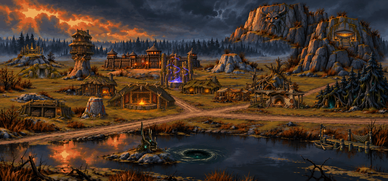
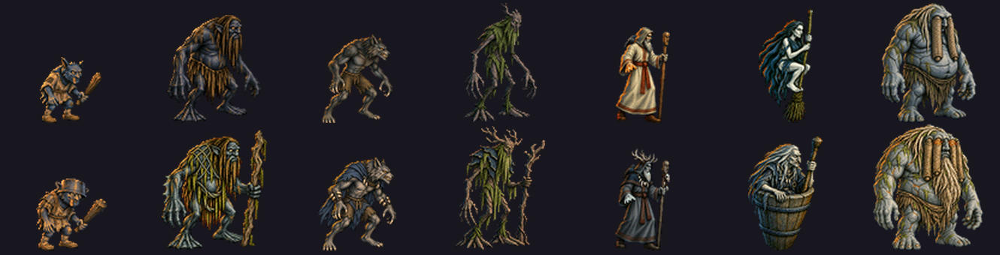

# Chernolesye

A dark Slavic town mod for [VCMI](https://vcmi.eu): forest, swamp and evil spirits.

Needs VCMI 1.7.0 or newer and the original Heroes of Might and Magic III data files.

## Why this mod

The idea came just before Halloween. I like The Witcher, and I like Slavic folklore: its spirits and monsters are colourful, but games rarely use them. I am Belarusian and I love Belarusian literature, so I wanted to build a Heroes III faction from the old Slavic creatures.

Light heroes are boring. Playing the "unclean" side is more fun, and these creatures are not simply evil. Picking the seven tiers was hard: each creature had to be easy to recognise and also interesting. For tier 7 I did not want one more dragon, so I chose Viy. He is not the most famous monster, but he is the final boss of Gogol's story.

I also wanted to see how fast and how well AI tools can automate making a mod, and to build one pipeline that gives a single style that looks native to the game. My earlier attempts at modding did not go well. This one did.

## The town

Chernolesye means "the black forest". The town stands in a swamp and a deep forest, because Slavic dark folklore is tied to bogs and old woods. The mage guild is a well of dreams.

## Sources

Folklore and books that I used as references:
- *Shlyakhtich Zavalnya, or Belarus in Fantastic Tales* by Jan Barszczewski (Barshchevsky)
- *Pan Tvardovsky*, the old legend
- Gogol's story *Viy*

## Creatures

| Tier | Creature | Upgrade |
|------|----------|---------|
| 1 | Zlydeny (goblin-like imp) | Senior Zlydeny |
| 2 | Bolotnik (swamp man) | Vodyanoy (water spirit) |
| 3 | Volkolak (werewolf) | Senior Volkolak |
| 4 | Leshy (forest spirit) | Senior Leshy |
| 5 | Volkhv (pagan priest) | Senior Volkhv |
| 6 | Witch | Baba Yaga |
| 7 | Viy | Awakened Viy |

## Heroes

Two classes: Lovchiy (hunter, might) and Vedun (sage, magic). The heroes are a first draft. I could not fully shape them yet, and they may change.

## Install

Copy this folder into the VCMI `Mods` folder and name it `chernolesye`.

- macOS: `~/Library/Application Support/vcmi/Mods/`
- Windows: `Documents\My Games\vcmi\Mods\`
- Linux: `~/.local/share/vcmi/Mods/`

Then enable **Chernolesye** in the VCMI Launcher.

## Install from the VCMI Launcher (extra repository)

1. In the VCMI Launcher open **Settings** and find **Repositories**.
2. Turn on the extra repository and paste this link:
   `https://raw.githubusercontent.com/yanmasharski/chernolesye/main/repository.json`
3. Open the **Mods** tab, press the update button if needed, find **Chernolesye** and install it.

The file [repository.json](repository.json) is the list the launcher reads. It points to the latest `main` branch.

## About VCMI

VCMI is a free, open source engine for Heroes of Might and Magic III. This mod is a fan project and is not part of VCMI.

- Website and downloads: <https://vcmi.eu>
- Source code: <https://github.com/vcmi/vcmi>
- Guides for players, including how to install and enable mods: <https://github.com/vcmi/vcmi/tree/develop/docs/players>
- Guides for modders, including how to make your own town: <https://github.com/vcmi/vcmi/tree/develop/docs/modders> (start with [Readme](https://github.com/vcmi/vcmi/blob/develop/docs/modders/Readme.md) and [Mod file format](https://github.com/vcmi/vcmi/blob/develop/docs/modders/Mod_File_Format.md))

## Status

Version 0.1.0, work in progress.

- Heroes use the vanilla Fortress sprites for now (Beastmaster and Warlock).
- Creatures have no sounds yet.
- Siege, music, boat and puzzle are borrowed from the vanilla Fortress.

## AI-generated art

Most images (creatures, buildings, portraits, icons) were made with AI image tools, then cut, scaled and fitted by hand and by script. The style follows the look of Heroes of Might and Magic III on purpose, so the town fits the game. Animation is minimal for now.

## Help wanted

Animations, balance, sounds and fixes are welcome. Open an issue or a pull request.

If you want to make your own faction in the same way, I am happy to share my pipeline. Today any fan can do this with AI tools: you do not need to be a graphic artist, a programmer or a game designer.

## License and rights

The mod files (config, images, texts) are licensed under
[CC BY-NC-SA 4.0](https://creativecommons.org/licenses/by-nc-sa/4.0/): free to share and adapt, with credit, not for commercial use, same license for derived work.

This is an unofficial fan mod. It is not affiliated with or endorsed by Ubisoft or the VCMI team.
Heroes of Might and Magic is a trademark of its owner.
The mod contains no files from the original game. It only refers to some of them by file name (for example hero sprites, siege and music of the Fortress), so you need your own copy of the game.
